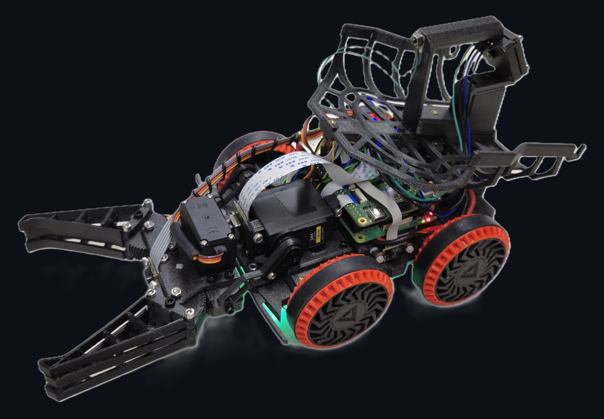
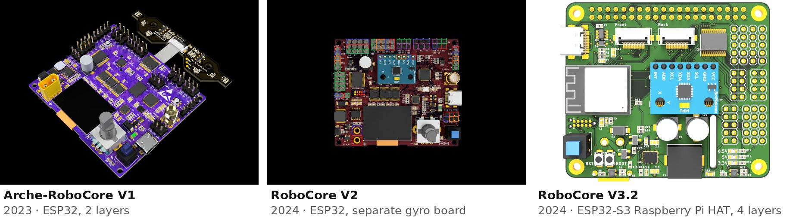
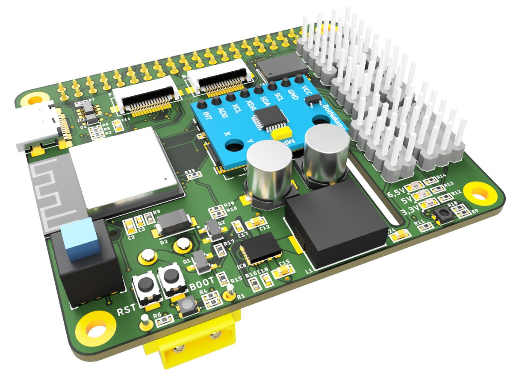
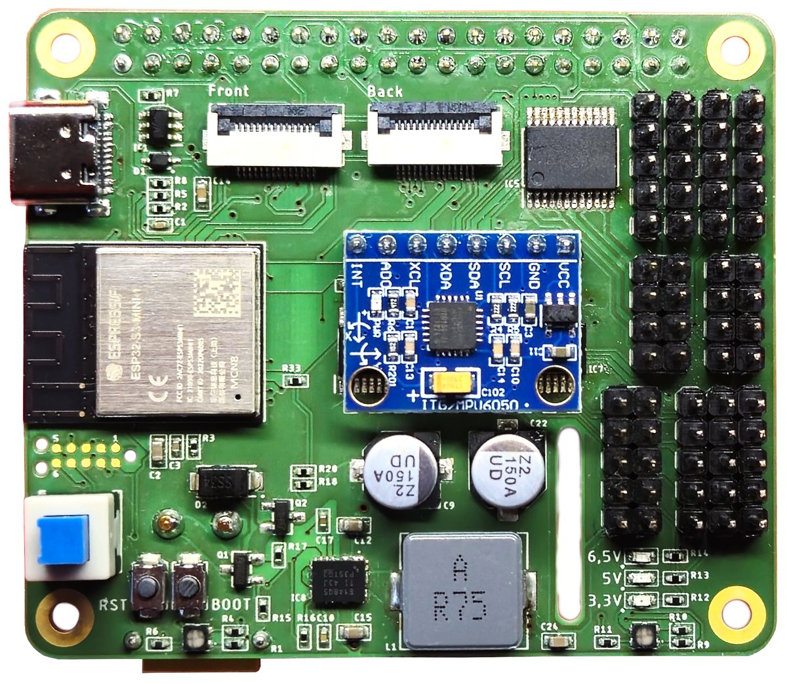
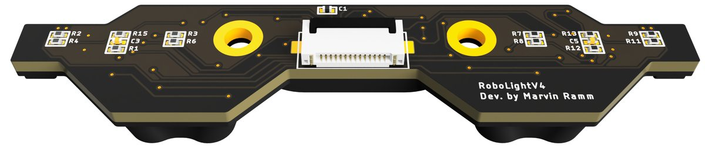
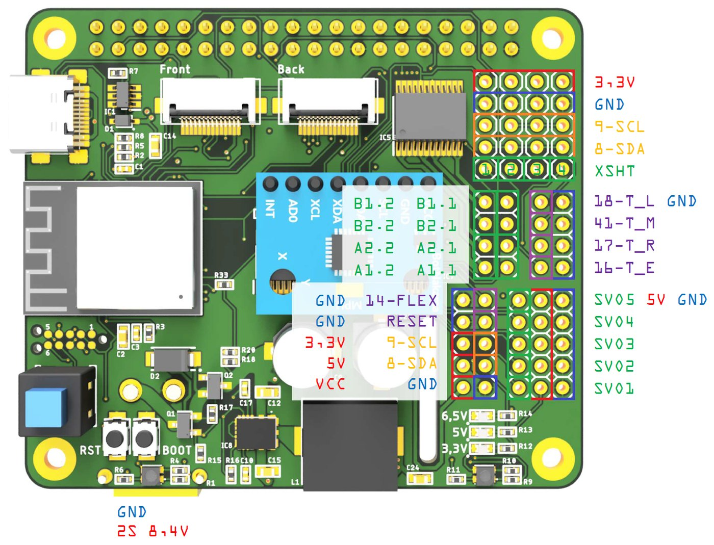

# RoboCore

[](LICENSE)
[](hardware/LICENSE)

**Open-source control electronics for RoboCup Junior Rescue Line robots: a Raspberry Pi HAT with ESP32-S3, four motor channels, servo / LED driver and a matching light sensor bar.**



RoboCore started in 2023 as a main board for RoboCup Rescue Line robots, and student teams have built their competition robots on it. It has gone through three generations, from a stand-alone ESP32 board to a 4-layer HAT that pairs the real-time control on the ESP32-S3 with a Raspberry Pi for image processing.



## RoboCore V3.2 – current version

<table>
  <tr>
    <td width="50%"></td>
    <td width="50%"></td>
  </tr>
</table>

| | |
|---|---|
| **MCU** | ESP32-S3-MINI-1-N8 (dual core, 8 MB flash, Wi-Fi / BLE), USB-C with native USB |
| **Host** | Raspberry Pi HAT form factor (40-pin header): the Pi can take over image processing while the ESP32 runs the real-time control |
| **Motors** | 2 × TB6612FNG → 4 DC motor channels, direction and standby via 74HC595 shift registers |
| **Servos / LEDs** | PCA9685 16-channel PWM: 5 servo ports + 2 RGB status LEDs |
| **Sensors** | MPU6050 IMU, up to 4 × VL53L1X ToF (individually enabled), flex sensor input, battery voltage |
| **Light sensors** | 2 × FFC connectors for the RoboLight bar (front and back) |
| **Power** | 2S Li-Po (8.4 V) via XT30, two buck converters (TPS54302, LM61480) for the 6.5 V and 5 V rails, AMS1117 for 3.3 V, polyfuse, USB ESD protection |
| **UI** | User button, inputs for four external buttons, I²C OLED port, status LED for every supply rail |
| **PCB** | 4 layers, 1.6 mm, 65.05 × 56.03 mm, min. trace 0.125 mm, Tag-Connect TC2050 programming port |

### RoboLight V4.3 – light sensor bar



Six phototransistors (four line sensors plus two reflection sensors) with white, red, green and RGB illumination, for detecting the black line, the green junction markers and the silver strip. The bar connects through a 14-pin FFC cable. 2 layers, 72.0 × 15.23 mm.

### Pinout



The complete GPIO table, shift-register and PWM channel mapping are in the [manual (PDF)](hardware/robocore-v3.2/RoboCore-V3.2_manual.pdf) and in [`Pins.h`](firmware/examples/ButtonTest/Pins.h).

## Repository layout

```
hardware/robocore-v3.2/     Main board: schematic, BOM, interactive BOM, ODB++ fab data, Fusion source, STEP, manual
hardware/robolight-v4.3/    Light sensor bar: schematic, BOM, ODB++ fab data, Fusion source, STEP
hardware/mechanical/        3D-printed parts (light shield, gyro protection), chassis renders
hardware/archive/           All previous revisions (Arche-RoboCore V1, RoboCore V2 / V3.1, light bars, RGB sensor)
firmware/examples/          Test sketches for every subsystem of RoboCore V3.2
docs/images/                Pictures used in this README
```

## Getting started

### Order the boards

The fabrication data in `hardware/*/fabrication/` is exported as **ODB++** (accepted e.g. by AISLER). All parts are listed in the BOM. For assembly, open the **[interactive BOM](hardware/robocore-v3.2/RoboCore-V3.2_interactive_BOM.html)**: download it and open it in a browser. It highlights every part on the board.

> ⚠️ If you use high-current batteries, add a large capacitor at the input. Always disconnect the battery before re-plugging anything, and check the pinout every time you change a connection.

### Flash the examples

1. Install the [ESP32 Arduino core](https://docs.espressif.com/projects/arduino-esp32/en/latest/installing.html) (tested with 2.0.17).
2. Install the libraries: Adafruit GFX, Adafruit BusIO, Adafruit SSD1306, Adafruit PWM Servo Driver, MPU6050_light, VL53L1X (Pololu).
3. Select **ESP32S3 Dev Module** with these settings:

   | Setting | Value |
   |---|---|
   | USB CDC On Boot | Enabled |
   | CPU Frequency | 240 MHz (WiFi/BT) |
   | Flash Mode | QIO 120 MHz |
   | Flash Size | 8 MB (64 Mb) |
   | Partition Scheme | 8M with SPIFFS |
   | Upload Speed | 921600 |

4. Open a sketch from [`firmware/examples`](firmware/examples) and upload it.

Or with arduino-cli:

```bash
arduino-cli compile --upload -p /dev/ttyACM0 \
  --fqbn esp32:esp32:esp32s3:CDCOnBoot=cdc,FlashSize=8M,PartitionScheme=default_8MB \
  firmware/examples/MotorTest
```

| Example | What it tests |
|---|---|
| `ButtonTest` | on-board and external buttons |
| `DisplayTest` | I²C OLED incl. line-follower status icons |
| `DualCore` | one FreeRTOS task per CPU core |
| `GyroTest` | MPU6050 angles |
| `I2CScanner` | lists all devices on the I²C bus |
| `MotorTest` | all four motor channels in both directions |
| `ReadBattery` | battery voltage via the on-board divider |
| `ReadLightValues` | raw values of the RoboLight bar |
| `ServoTest` | servos on the PCA9685 |
| `ShiftregisterTest` | all 16 shift-register outputs |

**Download mode:** if an upload fails, hold BOOT and RESET, plug in USB, release RESET, then release BOOT after a few seconds.

## Team branches

Student teams built their RoboCup robots on RoboCore. Each team keeps its competition software in its own branch:

| Branch | Team / contributors | Content |
|---|---|---|
| [`Arche-Rescue`](https://github.com/codemarv42/RoboCore/tree/Arche-Rescue) | Team Arche Rescue: [Salkin-Niklas](https://github.com/Salkin-Niklas), Valentin Schaar, Vincent von Schmidt | Competition code for Arche-RoboCore V1 and a Godot-based simulator of the RoboCup rescue room (2023–2024) |
| [`ImmernochKeinName`](https://github.com/codemarv42/RoboCore/tree/ImmernochKeinName) | Team ImmernochKeinName: [MasterOktagon](https://github.com/MasterOktagon) | Line-follower software and OKTAGON chassis for Arche-RoboCore V1 (2023–2024) |
| [`ImmernochKeinName-Rework`](https://github.com/codemarv42/RoboCore/tree/ImmernochKeinName-Rework) | Team ImmernochKeinName: [MasterOktagon](https://github.com/MasterOktagon) | Reworked code base with obstacle handling and a new line module (2024) |

The software in these branches belongs to the respective teams and keeps its own license (GPL-3.0).

## Hardware changelog

**RoboCore**

| Version | Changes |
|---|---|
| V3.2 | Neopixel LEDs removed (ADC interference), better regulator for the motor driver, extended power management |
| V3.1 | Raspberry Pi HAT design, ESP32-S3, external display and buttons, two motor drivers, new regulators |
| V2 | MPU6050 on a separate board, dual light sensor bar, pull-up fix for the buttons |
| V1 | Arche-RoboCore – first version, ESP32 |

**RoboLight**

| Version | Changes |
|---|---|
| V4.3 | FFC pinout swapped |
| V4.2 | Regular RGB LEDs, improved LED / phototransistor arrangement |
| V4.1 | Neopixel RGB LEDs, centre phototransistor removed |
| V3 | LEDs individually switchable via shift register |
| V2 | Corrected spacing of the inner phototransistors |
| V1 | First version |

## License

© 2023–2025 Marvin Ramm. Open source with attribution:

- Code (`firmware/`): [MIT](LICENSE)
- Hardware and documentation: [CC BY 4.0](hardware/LICENSE)

Commercial use is allowed. Credit "RoboCore by Marvin Ramm" with a link to this repository. Details are in [LICENSING.md](LICENSING.md).
